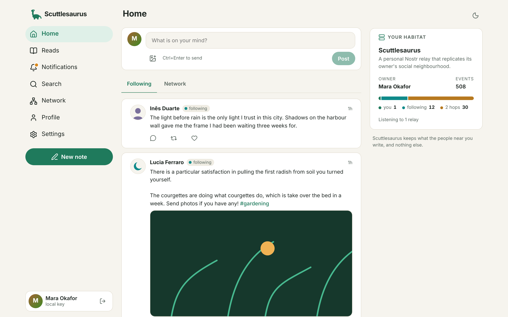
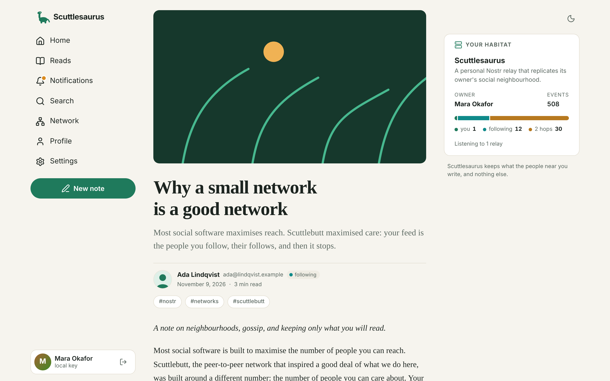
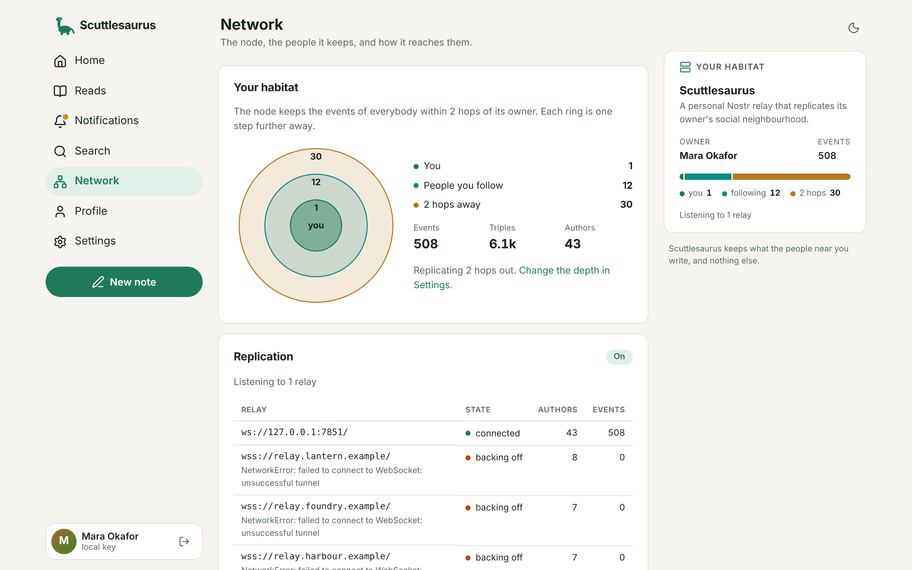

# Scuttlesaurus

Scuttlesaurus is a personal Nostr node. It keeps what the people near its owner
write, where "near" means social distance in follow hops, as Scuttlebutt did,
and nothing else. One program provides a relay that replicates that
neighbourhood, a web client for short notes and long-form articles, and a
Blossom media server, all on one port and one RDF graph.

| Home                                                      | An article                                                    | The node                                                                            |
| --------------------------------------------------------- | ------------------------------------------------------------- | ----------------------------------------------------------------------------------- |
|  |  |  |

## Quick start

You need [Deno](https://deno.com) 2.9 (tested with 2.9.6). Check with
`deno --version`.

```bash
git clone https://github.com/retog/scuttlesaurus.git
cd scuttlesaurus
deno task start
```

Open <http://localhost:7777>. On a node without an owner, the first screen asks
you to choose an identity or create one in the browser. That identity becomes
the owner, and the node starts keeping the events of the people around it.

To try the node with demo data, run this in a second terminal while the node is
running:

```bash
deno task seed
```

The seed fills the node with a small social world, makes `mara` its owner and
prints a login for her. Those keys are public demo keys.

With Docker, from a clone:

```bash
docker compose up -d
```

Then open <http://localhost:7777>. See
[docs/INSTALL.md](docs/INSTALL.md#run-with-docker) for the details.

## What it does

- **Relay.** A NIP-01 relay on the node's port. It accepts an event only when
  its author is in the social graph, which is the owner and the people within a
  few follow hops of the owner. Everybody may read.
- **Proactive replication.** The node fetches the notes, profiles, follows,
  articles and reactions of the people in its graph from the relays they publish
  to (the NIP-65 outbox model). It fetches recent history, then stays
  subscribed, so the events arrive as they are published.
- **Web client.** Notes with threads, reactions and reposts; long-form articles
  with an editor and comments; profiles, search, notifications, a page on the
  node itself, and the owner's settings.
- **Remote signing.** Sign in with a signer app such as Amber (NIP-46): the key
  stays in the app, the browser holds a connection key only. The relay carries
  the encrypted requests, from any author, without storing them.
- **Blossom media server.** Upload, fetch, list and delete media for authors in
  the graph.
- **SPARQL endpoint.** Read-only SPARQL 1.1 over everything the node holds, so a
  query can join a profile, a note and the counts of their reactions in one
  request.
- **Storage.** By default the graph is held in memory and kept as a log. It can
  instead be held by an external SPARQL 1.1 endpoint, or by QLever through
  qlever-dir.
- **No external services.** The node stores everything itself, the web client
  makes no requests to third parties, and no CDN is involved.

## How it works

The owner's follow list is the start. The node walks it outwards, breadth-first,
for `HOPS` steps (two by default), keeping at most `MAX_AUTHORS` authors. For
each of them it fetches events from their write relays, keeps the events in one
insert-only RDF graph and serves that graph to the relay, the web client and the
SPARQL endpoint. Events that clients publish to the node are checked against the
same graph and, by default, forwarded to the relays of their authors. The graph
only grows: a newer version of a profile or an article is added beside the old
one and marked as superseding it, and a deletion request is recorded the same
way.

```
Nostr clients, browsers, other nodes
                 |  one port (7777)
                 v
+----------------------------------------------+
| relay | web client | SPARQL | Blossom | API  |
+----------------------------------------------+
                 |
                 v
EventStore <---------- Replicator <---------- SocialGraph
    |                      |
    v                      v
RDF graph           relays of the people in range
(insert-only)
```

[ARCHITECTURE.md](docs/ARCHITECTURE.md) describes the modules, the replication
plan and the HTTP surface. [DATA-MODEL.md](docs/DATA-MODEL.md) describes how
events become triples.

### Supported NIPs and BUDs

| Spec           | What the node does with it                                                                                                                                    |
| -------------- | ------------------------------------------------------------------------------------------------------------------------------------------------------------- |
| NIP-01         | The basic protocol: events, subscriptions and the relay's messages on `/`.                                                                                    |
| NIP-02         | Follow lists (kind 3). They define the social graph.                                                                                                          |
| NIP-09         | Deletion requests (kind 5). The event stops being served; it stays in the log.                                                                                |
| NIP-10         | Reply threads of notes, from the `e` and `p` tags.                                                                                                            |
| NIP-11         | The relay information document, at `/` with `Accept: application/nostr+json`.                                                                                 |
| NIP-18         | Reposts (kind 6), stored and shown.                                                                                                                           |
| NIP-22         | Comments (kind 1111) on articles.                                                                                                                             |
| NIP-23         | Long-form articles (kind 30023), with the editor.                                                                                                             |
| NIP-25         | Reactions (kind 7), stored and counted.                                                                                                                       |
| NIP-45         | `COUNT` requests on the relay.                                                                                                                                |
| NIP-46         | Nostr Connect: the relay carries kind 24133 events from any author, unstored, and the web client signs through a signer app. `NOSTR_CONNECT=off` disables it. |
| NIP-50         | Search, as a case-insensitive substring match.                                                                                                                |
| NIP-65         | Relay lists (kind 10002). They tell the replicator where each author publishes.                                                                               |
| NIP-05, NIP-98 | Not on the list above, but used: the owner's NIP-05 identity at `/.well-known/nostr.json`, and NIP-98 authorization for the owner's API.                      |
| BUD-01         | Fetching blobs by hash: `GET` and `HEAD` on `/<sha256>`.                                                                                                      |
| BUD-02         | Uploading, listing and deleting blobs: `PUT /upload`, `GET /list/<pubkey>`, `DELETE /<sha256>`.                                                               |
| BUD-06         | Asking whether an upload would be accepted: `HEAD /upload`.                                                                                                   |

## Configuration

Settings come from built-in defaults, from `<DATA_DIR>/config.json` and from
environment variables, in that order. A setting given as an environment variable
is locked in the settings page. These are the settings most people change:

| Variable                | Default               | Meaning                                                                 |
| ----------------------- | --------------------- | ----------------------------------------------------------------------- |
| `OWNER`                 | none                  | The owner, as `npub1…` or hex. Set it for any public node.              |
| `PORT`                  | `7777`                | The port the node listens on.                                           |
| `HOSTNAME`              | `127.0.0.1`           | The address it listens on. `0.0.0.0` for all addresses.                 |
| `PUBLIC_URL`            | derived from requests | The address people use, such as `https://your.host`.                    |
| `HOPS`                  | `2`                   | How many follow steps from the owner are replicated.                    |
| `DATA_DIR`              | `./data`              | Where the graph, blobs and configuration are kept.                      |
| `SPARQL_ENDPOINT_QUERY` | none (embedded store) | The URL of an external SPARQL 1.1 endpoint, which then holds the graph. |

The full table, with every variable, is in
[ARCHITECTURE.md](docs/ARCHITECTURE.md#configuration-srcconfigts). To keep the
graph in QLever through qlever-dir, set `QLEVER_DIR_URL`; see
[INSTALL.md](docs/INSTALL.md#use-qlever-through-qlever-dir).

## Documentation

- [docs/INSTALL.md](docs/INSTALL.md): running it from source, with Docker,
  behind a proxy, with an external store; tuning replication; troubleshooting.
- [docs/ARCHITECTURE.md](docs/ARCHITECTURE.md): the design, the modules and the
  HTTP surface.
- [docs/DATA-MODEL.md](docs/DATA-MODEL.md): the graph, its IRIs and the mapping
  from events to triples.
- [docs/DEVELOPMENT.md](docs/DEVELOPMENT.md): tasks, tests, the demo world, a
  two-node replication recipe, and how to add an event kind.
- [vocab/nostr.ttl](vocab/nostr.ttl): the vocabulary as RDF.

## Status and limits

- This is the first version. The code is tested, but it has not been run for
  long on a public network.
- Replication has been tested only between local nodes and with the demo data.
  It has not yet been tested against the public relay network.
- The QLever store has been tested with qlever-dir 0.6.0 run outside Docker, on
  graphs of up to about ten thousand triples. Its Compose setup has not been
  run.
- The external SPARQL endpoint store has unit tests. The Oxigraph example in
  [docs/INSTALL.md](docs/INSTALL.md#use-an-external-triple-store) has not been
  run against an Oxigraph server.
- The embedded store keeps the whole graph in memory, at roughly 0.5 GB per
  million triples. A node with the default limits stays well below a million
  triples. Larger nodes should use a SPARQL endpoint.
- A deletion request stops an event being served, and deleted blob files are
  removed. The event itself stays in the append-only log.
- There is no NIP-42 authentication, no direct messages and no zaps.
- Signing in with a signer app (NIP-46) has been tested only against the
  stand-in signer in `scripts/fake_signer.ts`, not against Amber or another real
  app. Each signature may wait for a tap on the phone.
- A key created in the browser is kept in that browser's local storage. Anybody
  who can read that storage can use the key.

## History

The Scuttlebutt implementation that this project began as, Scuttlesaurus with
Tricerascuttler and Compsoscuttly, is in the git history before commit
`6ec00d2`, which replaced it with the Nostr node.
